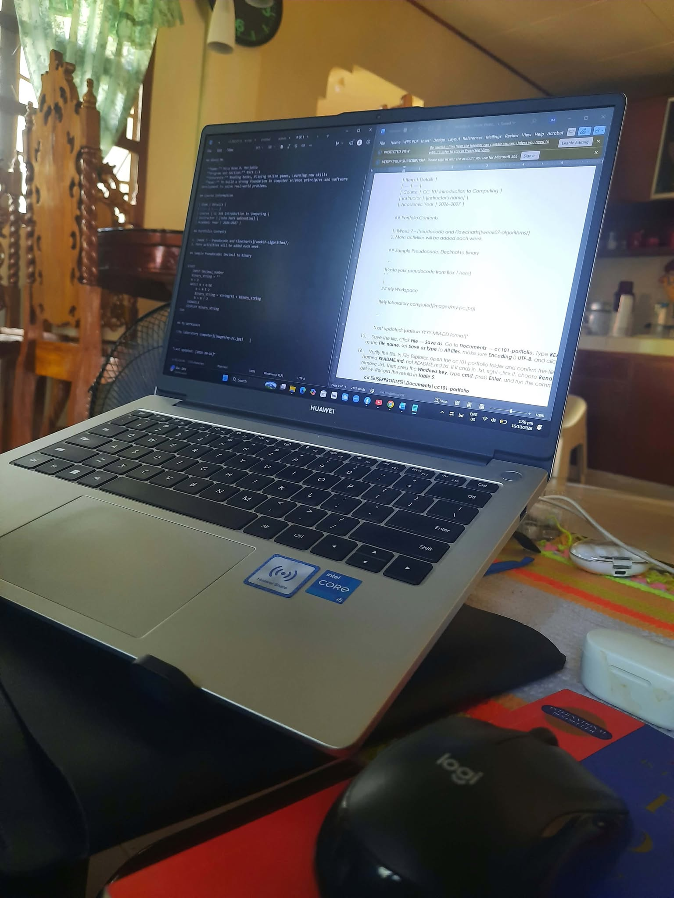

# CC 101 Computing Portfolio

This repository contains my laboratory outputs and documentation for *CC 101 Introduction to Computing* at **Sorsogon State University – Bulan Campus**.

## About Me

- **Name:** Mica Rose D. Merjudio
- **Program and Section:** BSCS 1-1
- **Interests:** Reading books, Playing online games, Learning new skills
- **Goal:** To build a strong foundation in computer science principles and software development to solve real-world problems.

## Course Information

| Item | Details |
| :--- | :--- |
| Course | CC 101 Introduction to Computing |
| Instructor | John Mark Gabrentina |
| Academic Year | 2026–2027 |

## Portfolio Contents

1. [Week 7 – Pseudocode and Flowcharts](week07-algorithms/)
2. More activities will be added each week.

## Sample Pseudocode: Decimal to Binary

```
START
    INPUT Decimal_number
    SET Binary_string = ''
    SET N = Decimal_number
    WHILE N > 0 DO
        SET R = N MOD 2
        SET Binary_string = String(R) + Binary_string
        SET N = N DIV 2
    ENDWHILE
    DISPLAY Binary_string
END
```

## My Workspace
 

 
---
 
*Last updated: [2026-10-16]*
